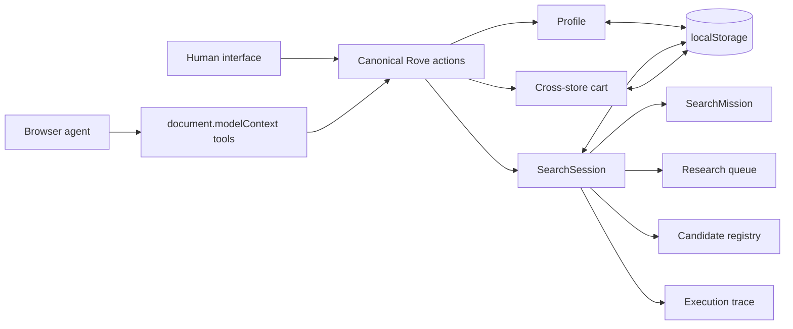

# Rove

> A shared fashion research workspace for people and browser agents.

[Live app](https://myrove.netlify.app/) · [Private Sites deployment](https://rove.chrisforyou.chatgpt.site/) · [Public source](https://github.com/Chris-Miracle/thread) · [MIT license](./LICENSE) · [WebMCP Challenge](https://webmcp.devpost.com/)

## Submission overview

Shopping research breaks down across tabs, retailer sites, chat transcripts, and carts. A browser agent can discover useful products, but the human usually cannot see, refine, preserve, or selectively replace those findings in a durable shared interface.

Rove makes that collaboration visible. The agent researches live retailer pages and progressively publishes grounded candidates into the same workspace the human is using. The human can inspect provenance, filter the edit, choose variants, accept or replace individual recommendations, save completed missions, and manage a cross-store Thread without losing the research state.

WebMCP is the product boundary, not a decorative integration:

- one sentence such as “I’m going on a vacation to Cancun, get me three clothes and a perfume, two footwears with a budget of $450 CAD” becomes a planned, budget-allocated mission that an agent can run end to end by following Rove’s `next` steps; a photo in the brief becomes the style guide;
- twenty-five imperative `document.modelContext` tools expose profile, mission planning, retailer scheduling, candidate publication, enrichment, review, fresh research, history, inspiration, similarity, cart, and per-store checkout handoff actions;
- a compatible WebMCP agent calls Rove’s built-in anonymous Shop catalogue transport; no local CLI, Shop plugin or login is needed for discovery;
- every human and agent mutation passes through the same typed domain action layer;
- browser agents receive constrained retailer targets and structured next actions instead of relying on one oversized prompt;
- candidate URLs, images, budgets, retailer domains, mission identity, variants, and duplicate history are validated before entering shared state;
- the application remains a complete, usable static fashion workspace when WebMCP is unavailable.

No sign-in, API key, or test credentials are required. Open the [live app](https://myrove.netlify.app/) in ChatGPT's in-app browser, or in Google Chrome 149 or later after enabling `chrome://flags/#enable-webmcp-testing` and restarting Chrome.

## Challenge-period provenance

This repository was initialized on August 27, 2026, after the challenge submission period opened on August 25. The initial commit contained only the MIT license and a two-line README; the Rove application and its WebMCP implementation were built in subsequent commits from August 30 through September 2. The dated [public commit history](https://github.com/Chris-Miracle/thread/commits/main/) provides the implementation record. Rove is not a pre-existing application being submitted on the strength of earlier work.

Rove’s product thesis is:

> “Rove is a shared fashion research workspace where a browser agent researches the open web and progressively publishes products into the same workspace that the human is simultaneously browsing, filtering, inspecting, and curating.”

The browser agent supplies web navigation and intelligence. Rove supplies the typed shopping mission, profile, retailer semantics, deterministic research scheduler, candidate validation, product ranking, persistence, cart, human interface, and WebMCP tools.

Rove is a client-only Nuxt 4 / Vue 3 / strict TypeScript / Tailwind application for the [OpenAI WebMCP Challenge](https://openai.com/webmcp-challenge/). It has no backend, database server, API key, OpenAI API call, embedded chatbot, MCP server, scraping service, product-aggregation service, account system, or cloud persistence. The static build remains usable when WebMCP is unavailable. Rove calls the anonymous read-only Shop HTTP API directly from the browser; it holds no Shop token and runs no proxy. Account and checkout operations use an optional official agent binding.

## Human and agent share one state



Human and WebMCP operations converge on one canonical domain action layer; the UI does not maintain a parallel implementation. A human can keep filtering, browsing, opening details, and managing the cart while the browser agent claims retailer work and progressively publishes products.

Rove supports one workspace tab plus browser-agent-controlled retailer tabs. Cross-tab Rove state synchronization is intentionally not claimed. Search IDs and target claims prevent old retailer workers from publishing into a replacement, cancelled, or completed mission.

## SearchMission

`start_shopping_search` is the only normal entry point for a shopping request. It stores:

- the original prompt;
- shopping department and style preferences;
- optional trip, destination, climate, occasion, and notes;
- concrete needs with retailer-search queries, category signals, required quantities, and optional per-need CAD budgets;
- explicit per-item and overall CAD budgets, category, retailer, and exclusion constraints;
- the final deduplicated query set and creation time.

The browser agent can provide structured semantic context, but Rove plans a plain-language brief on its own, deterministically, without an LLM. See [Hands-off missions](#hands-off-missions). A bare “Get my clothes for vacation in Cancun” still expands into resort-daytime, beach/pool, and evening-dinner needs.

## Hands-off missions

The target experience is one sentence, with or without a photo:

```text
I’m going on a vacation to Cancun, get me three clothes and a perfume, two footwears with a budget of $450 CAD
```

**1. Brief planning** (`domain/search/briefParser.ts`). A lexicon-based slot filler reads each item with its quantity (“three clothes”, “a perfume”, “two pairs of sandals”, “4 white linen shirts”), keeps descriptive words as search terms, and maps nouns to categories. “Clothes” expands by climate and department: tops, bottoms, dresses and swimwear for a hot trip; no dresses for men; outerwear for cold places. A destination gazetteer supplies the climate, and climate-aware query banks supply the searches (“linen shirt, sundress, swimsuit”, “flat sandals, espadrilles”, “citrus eau de parfum”), ordered so the first three Shop searches already cover different slots. Budget scope comes from cue words: “budget”, “total” and “spend” cap the basket; “each”, “per item” and “under” cap one item. A counted multi-item brief without a cue reads as a basket budget. A saved per-item budget never overrides a basket budget stated in the brief. Each item becomes a required need with its exact quantity, and the item categories become the hard category constraint.

**2. Budget allocation** (`domain/search/priceModel.ts`). Category price priors (typical and low CAD prices) split the basket budget in proportion to quantity × typical price. Each item also gets a feasibility ceiling: the budget minus the cheapest plausible cost of every other slot. Shop price caps use the tighter of twice the item’s share and that ceiling, so searches stay in a realistic range without excluding items the basket could still afford.

**3. Basket optimization** (`domain/research/fulfillment.ts`). The proposed basket is a multiple-choice knapsack:
- **Choice:** exactly the requested quantity per required need (optional needs may take fewer), within every per-need budget and the overall budget.
- **Objective:** maximize relevance minus a value term for spending beyond the item’s share.
- **Solver:** dynamic programming over a 600-cell budget grid. Costs round up, so the chosen basket never exceeds the real budget. A single-swap local search then penalizes near-duplicates, three pieces from one category, and one-store baskets.
- **Shared products:** a product matching several needs fills the scarcest one.
- **Stopping:** “satisfied” means the basket fits. Research stops early only when it is also “ready”: every required need had at least two real alternatives beyond its quantity.

**4. Ranking** (`domain/products/productRanking.ts`). Products are scored against their own need’s queries, their fit with that need’s budget share, and, with a guide image, a visual match.

**5. Image guidance.** A photo in the brief, passed by the agent as `referenceImage`, or an inspiration board image passed as `inspirationId`:
- **Board and palette:** the photo joins the inspiration board, downscaled to a small JPEG. Its colours come from in-browser k-means in CIELAB, with the background cluster that owns the image border removed, then each cluster is named by its nearest fashion colour.
- **Guide and searches:** the photo becomes the mission’s `visualGuide`, and every wearable need gets its own Shop visual search (`like` image plus the need’s first query) ranked ahead of text searches. Perfume is never image-guided.
- **Shop hint:** the palette and any `visualCues` the agent describes go into Shop’s `context.intent` relevance hint, together with the trip and styles.
- **Storage:** image bytes reach claimed targets only, never the saved mission.

Without a photo the mission runs entirely from the brief.

**6. Runbook.** `start_shopping_search`, `claim_search_targets`, `complete_search_target`, `get_search_status` and `review_recommendations` all return `next`: ordered steps with complete arguments. Each step is addressed to Rove, to the agent’s Shop connection (`search_catalog`, `get_product`), to the browser, or to the person (`present_basket`, `choose_size`). After acceptance, `cart_proposed_basket` adds the basket to Your Thread in the person’s saved sizes. Pieces that still need a stock check or a size choice come back as exact Shop or person steps; Rove never guesses a size or relaxes it.

## Retailer adapters and research queue

`app/data/retailers.ts` is a registry of retailer adapters. Each adapter owns:

- canonical domains and phrase-safe aliases;
- supported departments;
- categories, styles, occasions, price tier, and retailer type;
- a search URL template;
- product URL/domain semantics.

Retailers are scored from department compatibility, category coverage, style and occasion overlap, budget/price-tier fit, profile preferences, and warm-weather relevance. Results are sorted by score and a stable retailer ID tie-breaker, so registry array order cannot determine priority. Generic substring aliases such as `shop` are not used.

Every eligible retailer becomes a persisted target. Each target keeps only the mission needs, queries, and URLs that its declared category capabilities support. Discovery sources are scheduled last unless the mission explicitly restricts retailers. Targets move through:

```text
queued → claimed → exploring → complete
                           ↘ no-results
                           ↘ failed
queued / claimed / exploring → cancelled
queued → skipped (only after required needs are satisfied)
```

`claim_search_targets` returns only 1–4 targets at a time. Priority is recalculated at every claim from the needs that remain unfulfilled, with extra weight for required and scarce capabilities such as fragrance. Each target contains a small need-specific query set and browser-ready URLs. `complete` requires at least one accepted product (for the Pinterest target, at least one pinned image); zero-product checks must use `no-results` with a reason, and failures require a reason.

Rove builds a deterministic, budget-optimized proposed basket from grounded products with verified CAD prices. A mission may stop early only when the basket is ready: every required quantity fits its per-need budget and the overall budget, every required need had real alternatives, no target is still claimed or exploring, and no similarity search the person asked for is still queued. Every untouched queued target is retained as `skipped` with the reason “skipped after satisfaction.” Otherwise the full plan continues. The original target plan is never rewritten to manufacture completion.

## Candidates, enrichment, integrity, and ranking

Product publication is intentionally two-stage:

1. `publish_candidates` accepts listing-page candidates with canonical `url`, `name`, and a direct product `image` as required fields. Price, brand, category, and department can be supplied when observed.
2. `enrich_product` adds variants, availability, material, description, tags, and detailed pricing when the user inspects or wants to cart a candidate.

Rove derives canonical product ID, search ID, target ID, observed time, source, and known retailer identity. For known retailers, submitted names never override the registry. Retailer targets reject products from another domain. Discovery targets may introduce an unknown canonical retailer product page, but never a search, Pinterest, Google, social, placeholder, or root URL.

Hard mission constraints are enforced inside Rove:

- shopping department;
- explicit category;
- retailer allow/exclusion lists;
- active search ID;
- per-item CAD budget;
- target and product domain;
- product-like canonical URL.

Pricing keeps `nativePrice`, `nativeCurrency`, and `priceCad` separate. CAD listings derive `priceCad` directly. Non-CAD listings require an explicitly verified `priceCad`; Rove never guesses an exchange rate or compares unlike currencies.

The active session retains up to 600 unique candidates. When the documented limit is reached, new unique candidates are explicitly rejected; existing data is never silently truncated. Rove refuses to replace an active mission; it must first be completed, satisfied, cancelled, or explicitly abandoned. Up to three terminal sessions are retained as read-only recent searches, while cart snapshots remain stable.

Recommended order is deterministic rather than arrival order. It combines mission/query/category relevance, profile style match, occasion match, budget fit, retailer relevance, availability, freshness, and completeness. A greedy diversity pass then applies retailer repetition and near-duplicate penalties plus category-coverage bonuses.

## Shop-backed research

Rove provides anonymous Shop catalogue discovery directly from the visitor’s browser through `search_shop_catalog` and exact-option verification through `inspect_shop_product`. The transport discovers the official HTTP endpoint, checks read-only tool contracts, omits cookies/credentials, bounds requests to 30 seconds, preserves merchant messages, and reports actual failures. No installed CLI, Shop MCP plugin, backend or developer machine is required. Read [the integration guide](public/shop.md) and [Shop’s official skill](https://shop.com/skill.md). Agents still inspect evidence and publish suitable products through the shared validation layer.

**Shop catalogue targets.** Every mission need gets a `catalog:{needId}` target, ranked first and claimed first while its need is unmet. Its `catalogRequests` map Rove’s own data onto Shop filters:

| Rove | Shop `search_catalog` |
| --- | --- |
| need queries (up to three) | one `query` each |
| per-need or mission CAD budget | `filters.price.max` in cents |
| department | `Target gender`: `Female`/`Male` plus `Unisex` (Shop’s exact labels) |
| profile size for a single sized category | `Size` with merchant synonyms (`M` → `M`, `Medium`) |
| restricted retailers | `filters.shops` storefront domains |
| profile delivery country/province | `context.address_country` / `address_region`, currency always `CAD` |

Only an actual failed Shop request establishes a connection failure; preserve its reason and resolve the target as failed. Empty successful searches are no-results. Missing agent CLI/MCP tools do not justify skipping the built-in browser transport. Retailer browsing continues for unmet needs, preserving each need’s named-store constraints. Resolving an unfamiliar store retains registered retailer fallbacks. When Shop satisfies the basket, the existing early-satisfaction rule skips the browsing it no longer needs.

**Provenance and identity.** Shop candidates must carry `shop` provenance (product, variant, and seller IDs) and are rejected on non-Shop targets. Rove keeps the exact returned variant URL, every query parameter included, as `commerce.url` for links, while identity uses the canonical page without `variant` or Shop’s per-search `_gsid`, so a Shop result and a browsed copy of the same page merge. Sellers resolve by storefront host, never by Shop’s `*.myshopify.com` seller domain. Prices arrive in minor units and convert with each currency’s own decimal places; non-CAD prices still need a verified `priceCad`, and Rove’s budget check stays authoritative because Shop’s price filter is an approximate USD conversion.

**Exact variants and checkout handoff.** `enrich_product` accepts exact Shop variants. Adding a size or colour stores the matching variant ID and refuses sold-out combinations. `get_checkout_plan` groups Your Thread by seller: Shop sellers list variant IDs (or a ready `get_product` lookup when one is missing), and other stores keep their retailer links. Only when the user asks, the agent creates a Shop cart or checkout and calls `attach_merchant_cart` with the unchanged `continue_url`, the merchant total, and every message. The drawer then shows “Checkout ready”, “Out of date” when that seller’s items change, or “Ordered” after `record_purchases` reports a completed checkout. Rove never completes a purchase or stores payment, address, or email data.

**Reference images.** An image supplied by the person to the agent can become the mission guide via `referenceImage`. The reference section appears only for uploaded images. Product similarity buttons and the empty image uploader are hidden. The `find_similar` and inspiration tools remain available to agents for requested follow-up research; Pinterest discoveries alone do not reveal the reference section.

**Purchase signals.** `record_purchases` turns Shop checkouts and order history into two signals only: purchased product families join the never-repeat list, and brands become style cues in `start_shopping_search`.

## Discovery interface and commerce boundary

Products render in an aligned responsive grid: two columns on mobile, three to four on tablet, and five to six on wide desktop screens. Consistent image proportions keep sparse and full edits visually balanced, new candidates enter progressively, and existing filters and scroll position are not reset by publication.

The human can filter by retailer, brand, category, and verified CAD price; sort by recommendation, price, or observation time; inspect candidate provenance; open the canonical product page; and add enriched variants to the cart.

Your Thread is a cross-store meta-cart, not a unified checkout or inventory system. Shop products require one exact verified variant with every merchant option, including fragrance volume and accessory size. Non-Shop products retain their listing-specific size/colour policy. Candidate-only products must be enriched or opened at the retailer. Checkout always happens on the merchant’s side: through a returned Shop item `checkout_url` or a per-store `continue_url` prepared by the agent, or on each official retailer page.

## WebMCP tools

Rove registers twenty-five imperative tools:

| Tool | Mode | Purpose |
| --- | --- | --- |
| `get_profile` | Read only | Read all saved profile fields. |
| `setup_profile` | Mutating | Create the minimal profile without overwriting existing data by default. |
| `update_profile` | Mutating | Incrementally learn optional user-approved preferences. |
| `start_shopping_search` | Mutating | Create and persist one structured mission and ranked queue. |
| `resolve_store` | Mutating | Verify the official domain of an unfamiliar named store before research. |
| `claim_search_targets` | Mutating | Claim 1–4 queued targets prioritized around unmet needs. |
| `publish_candidates` | Mutating | Validate and upsert inexpensive listing-page candidates. |
| `enrich_product` | Mutating | Hydrate one candidate for detail, availability, or cart use. |
| `complete_search_target` | Mutating | Resolve a target as complete, no-results, or failed. |
| `get_search_status` | Read only | Read mission, fulfillment/budgets, target states, coverage, and next action. |
| `get_products` | Read only | Page/filter/sort up to 100 ranked products at a time. |
| `review_recommendations` | Mutating | Accept a completed edit or replace only selected products. |
| `research_again` | Mutating | Start a fresh pass without repeating prior product links. |
| `get_research_history` | Read only | Read saved prompts and accepted edits. |
| `cancel_search` | Mutating | Cancel or abandon unresolved work while preserving accepted products. |
| `get_cart` | Read only | Read the exact shared cart and CAD total. |
| `add_to_cart` | Mutating | Add an enriched exact product variant. |
| `remove_from_cart` | Mutating | Remove one stable cart item. |
| `get_checkout_plan` | Read only | Group the cart by seller with exact Shop variant lines or retailer links. |
| `attach_merchant_cart` | Mutating | Store a Shop `continue_url`, merchant total, and messages for one seller. |
| `add_inspiration` | Mutating | Pin a Pinterest image to the shared inspiration board. |
| `get_inspiration` | Read only | Read the board, including ready `like` entries for uploaded photos. |
| `find_similar` | Mutating | Search for pieces like a product or inspiration image. |
| `record_purchases` | Mutating | Record confirmed purchases as never-repeat links and brand cues. |
| `cart_proposed_basket` | Mutating | Add the accepted basket to Your Thread in the person’s sizes, or return exact next steps. |

Every schema rejects additional properties. Mutating tools have `readOnlyHint: false`; externally sourced product/retailer outputs use `untrustedContentHint: true`. Registration is client-only, feature-detects `document.modelContext`, prevents duplicates, and tears down with one `AbortController`.

The registration path is equivalent to this literal Imperative API shape:

```ts
const controller = new AbortController()

await document.modelContext.registerTool({
  name: 'get_profile',
  title: 'Get Rove profile',
  description: 'Read the browser-local shopping profile before starting a mission.',
  inputSchema: {
    type: 'object',
    properties: {},
    additionalProperties: false,
  },
  annotations: {
    readOnlyHint: true,
  },
  execute() {
    return { profile: actions.getProfile() }
  },
}, { signal: controller.signal })
```

Rove uses `document.modelContext`, not `navigator.modelContext`, a custom MCP server, or declarative form tools.

## Run and verify

Requirements: Node.js 22+ and npm.

```bash
npm install
npm run dev
```

Nuxt normally prints `http://localhost:3000`. Production checks:

```bash
npm run test
npm run typecheck
npm run generate
npm run build
```

The static output is generated under `.output/public`.

## Recommended live-agent demo

Complete onboarding (add a top size and shoe size), then ask, optionally attaching a photo:

```text
I’m going on a vacation to Cancun, get me three clothes and a perfume, two footwears with a budget of $450 CAD
```

The agent passes the sentence (and any photo as `referenceImage`) to `start_shopping_search`, then executes each returned `next` step until Rove asks it to present the basket. In terms of tools, that loop is:

```text
get_profile
→ start_shopping_search
→ claim_search_targets
→ Shop catalogue targets: send catalogRequests to Shop search_catalog
  (or fail with the actual transport error; an empty successful search is no-results)
→ retailer targets: browse returned retailer URLs
→ Pinterest target: add_inspiration for 3–6 pins
→ publish_candidates (multiple products per listing where relevant)
→ enrich_product (only when detail/variant verification is useful)
→ complete_search_target
→ claim_search_targets
→ repeat until get_search_status reports satisfied or completed
→ get_products
→ add_to_cart / get_cart
→ find_similar (optional agent-requested follow-up)
→ get_checkout_plan → Shop create_cart/create_checkout when asked
→ attach_merchant_cart → record_purchases after a completed checkout
```

Representative mission creation:

```json
{
  "rawPrompt": "Get my clothes for vacation in Cancun.",
  "context": {
    "tripType": "vacation",
    "destination": "Cancun",
    "climateHints": ["hot", "humid", "tropical"],
    "occasions": ["vacation", "beach", "resort", "dinner"]
  },
  "needs": [
    {
      "intent": "resort daytime",
      "queries": ["linen shirt", "relaxed shorts"],
      "categories": ["tops", "bottoms"]
    },
    {
      "intent": "beach",
      "queries": ["swimwear", "sandals"],
      "categories": ["swimwear", "footwear"]
    },
    {
      "intent": "evening dinner",
      "queries": ["linen trousers", "knit polo"],
      "categories": ["bottoms", "tops"]
    }
  ]
}
```

Also verify the simpler request `Find me a black shirt under $70 CAD`; Rove should store a tops constraint, enforce the CAD budget, and still schedule retailers by relevance rather than registry order.

## Project structure

```text
app/
├── components/              human workspace, product grid, progress, cart, debug
├── composables/             canonical browser-local state access
├── data/
│   ├── products.ts          development/test fixtures only
│   └── retailers.ts         retailer adapters and deterministic scoring
├── domain/
│   ├── cart/                seller grouping, Shop variant matching, checkout handoff
│   ├── products/            candidate validation, enrichment, ranking, diversity
│   ├── profile/             schema validation and migration
│   ├── research/            target scheduler, Shop request mapping, basket optimizer, agent runbook, telemetry
│   ├── search/              brief parser, price priors and budget allocation, SearchMission
│   └── persistence.ts       versioned hydration/migration
├── plugins/                 state hydration and client-only WebMCP registration
├── types/                   strict domain contracts
└── webmcp/                  closed schemas, outputs, registration, tools
tests/                       deterministic unit/integration tests
tests/fixtures/shop/         trimmed real Shop search_catalog/get_product responses
```

## License

Rove is open source under the [MIT License](./LICENSE).

## Shop reliability and agent setup

Rove is the shared interface and policy layer with a built-in read-only Shop browser HTTP client. The full agent guide is [`public/skill.md`](public/skill.md), with Shop details also served at `/shop.md`. Optional account/checkout operations use the agent’s official Shop binding. Rove does not embed a Shop token, run a shopping backend, or claim connectivity merely because WebMCP registered. Anonymous discovery is supported; account login remains optional. Start-search responses advertise the official skill and the agent binding.

Named registered retailers constrain the catalogue directly. For unfamiliar stores the agent supplies `storeNames`, follows `resolve_store` after verifying the official storefront, and then receives hard `filters.shops` requests. Explicit domains use `storeDomains`. Unresolved stores block claiming; products outside the requested storefronts are rejected.

Shop enrichment accepts one exact variant and compares its complete returned options with `requestedOptions` (or the previously published selection). Changed volume, missing width/finish/size, wrong product IDs, unavailable selections and inconsistent prices must never be treated as successful substitutions. Every Shop cart item needs an exact verified variant and CAD price. Independent size/colour lists cannot authorize a combination. Cart identity includes the variant ID, so two fragrance volumes remain separate and preserve their own prices.

Your Thread displays every selected merchant option. A returned variant `checkout_url` is preserved as `checkoutUrl` and opens directly from the item. For a multi-item merchant checkout, `get_checkout_plan` supplies a `create_checkout` request; the agent executes it only when asked and attaches its unchanged `continue_url`, total and every message. Non-Shop items retain retailer links. Rove never completes payment.

Product cards omit similarity controls. The reference-image section appears only when an agent has supplied an uploaded reference image; Pinterest pins and an empty uploader do not reveal it.

### Browser and region requirements

The static deployment runs the same Shop HTTP transport on desktop and mobile, independently of developer tooling. A compatible WebMCP agent and Internet access are still required for conversational missions; an ordinary browser alone cannot execute the prompt. Delivery country/region come from the visitor’s local profile. Budgets remain CAD, and retailer adapters currently link to Canadian storefronts; agents must use official country selectors for other destinations and verify shipping. Merchant coverage, CAPTCHA, availability and delivery are external limits. No deployment is implied by local verification.
